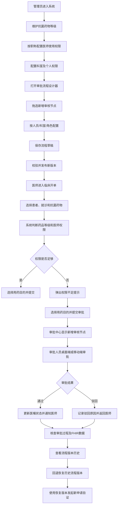
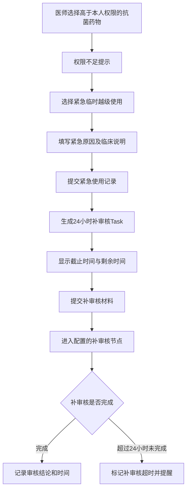
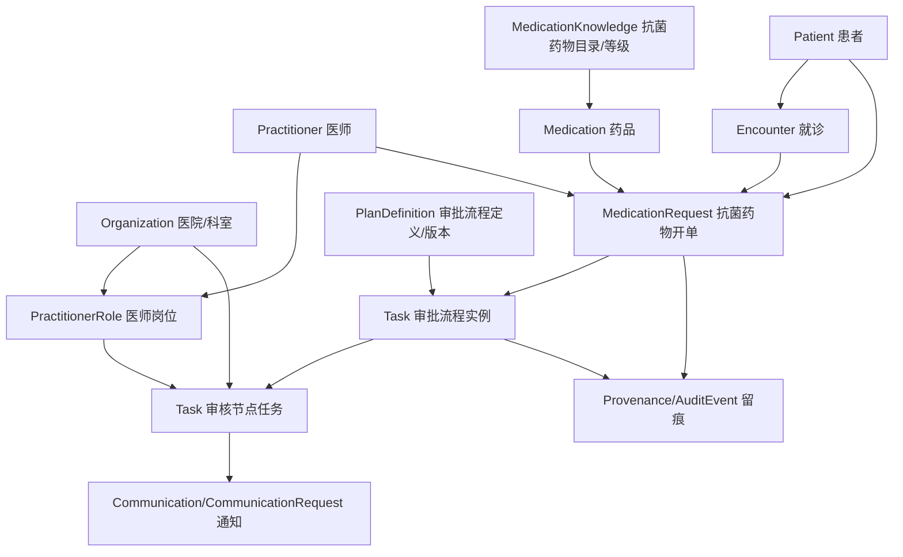

# 抗菌药物分级管理系统前端程序软件需求规格说明书（SRS）

- 文档版本：V1.0
- 文档类型：软件需求规格说明书（仅功能需求）
- 建设对象：抗菌药物分级管理系统前端演示程序
- 数据标准：HL7 FHIR R4（4.0.1）
- FHIR 服务：HAPI FHIR 公共测试服务器
- FHIR Base URL：`https://hapi.fhir.org/baseR4`

---

## 1. 文档目的与依据

### 1.1 文档目的

本文档定义“抗菌药物分级管理系统”前端演示程序的功能需求、业务角色、业务状态、交互流程、演示用例及 FHIR 数据映射。前端直接通过 FHIR REST API 读写 HAPI FHIR 公共测试服务器，不建设独立业务后端。

本系统的核心演示主线为：

**配置抗菌药物分级与医师权限 → 配置并发布审批流程 → 医师开立抗菌药物 → 系统按权限判断 → 触发审批或允许使用 → 审批中心处理任务 → 移动端审批 → 医师查看最终结果 → 紧急越级使用及24小时内补审核 → 查看流程版本并回退恢复。**

### 1.2 采购需求依据

本 SRS 以《采购需求(1).docx》中“抗菌药物分级管理系统”条款为直接依据。采购条款原有结构为：

1. 抗菌药物规则设置；
2. 抗菌药物分级管理；
3. 抗菌药物用药目的管理；
4. 审批流程扩展（明确要求提供系统功能演示）。

采购文件明确要求的演示原文如下，完整保留：

> ●审批流程扩展：对特殊药品医生开单后审批流程的自定义扩展并无感发布，在流程引擎中可拖选配置新的审核节点，支持按人员/科室/角色进行配置，保存发布之后进行开单操作，在审核中心模块可查看流程中新增节点的展示，并支持APP移动端审核操作，支持查看流程历史版本并回退恢复版本。（提供系统功能演示）

### 1.3 采购原文要求与演示补充设计的区分

- **采购明确要求**：本 SRS 中标记为“采购要求”的功能必须实现并可通过界面操作验证。
- **闭环演示设计**：为使演示从规则配置真正运行到审批完成，增加的患者/医师样例、审批任务状态、流程实例追踪、操作留痕、演示数据重置等属于前端演示实现设计，不代表采购文件另有同名条款。
- **示例规则**：演示用药目录、医生职称、权限等级、审批人及审批节点均为可配置的虚构样例；采购文件没有给出具体药品清单、具体职称与药物等级的映射表或具体审批岗位，系统不得将演示样例固化为医院正式用药制度。

### 1.4 本系统范围

本系统聚焦抗菌药物使用等级、医师授权、开立时权限校验、分级审批、紧急越级使用后的24小时内补审核、用药目的选择，以及审批流程的可视化扩展与版本管理。

本系统需提供模拟临床开单入口和移动端审批界面，以演示分级规则如何嵌入临床业务流程。模拟临床开单用于发起演示，不替代完整HIS、门诊医生工作站或住院医生工作站。

### 1.5 不纳入本系统范围的事项

以下事项在采购文件中属于其他标的或第三方系统能力，不作为本 SRS 的独立功能范围：

1. 合理用药系统的完整处方前置审方、药物相互作用审查、剂量审查、处方点评及抗菌药临床应用监测网填报。
2. 医院HIS、门诊/住院医生工作站的完整医嘱管理、药房发药与收费结算。
3. 院内会诊管理系统的完整会诊业务。采购文件另有“抗菌药物院内会诊审批流程”要求，本系统提供会诊审批流程的关联信息和审批入口，不替代院内会诊系统。
4. 真实药品库存、真实处方执行、医保结算、CA签名及真实医院消息平台。
5. 未在采购条款中提出的抗菌药物专项点评、使用强度统计和国家监测网报表等功能。

---

## 2. 系统用户与业务角色

### 2.1 系统管理员

- 维护演示用户、组织科室和角色数据。
- 初始化或恢复演示数据。
- 查看系统使用的当前 FHIR 服务和演示数据标识。

### 2.2 抗菌药物管理规则管理员

- 维护抗菌药物等级。
- 按医生职称配置抗菌药物使用权限。
- 维护医生个人和科室的权限关系。
- 配置审批流程、审核节点和审核对象。
- 发布流程版本、查看历史版本并执行回退恢复。

### 2.3 开单医师

- 在临床开单模拟界面选择患者、就诊、抗菌药物和使用方案。
- 查看本人抗菌药物使用权限及药品等级。
- 在权限不足时查看系统提示并发起审批。
- 提交抗菌药物使用目的。
- 在紧急情况下发起临时越级使用，并按流程完成24小时内补审核。
- 查看本人开单及审批任务进展。

### 2.4 审批人员

- 在审批中心查看分配给本人、所在科室或所在角色的任务。
- 查看患者、就诊、药物等级、开单医师、用药目的、申请原因和流程节点。
- 执行通过、驳回或退回补充等流程配置允许的操作。
- 查看本人待办、已办及任务详情。

### 2.5 移动端审批人员

- 在移动端审批工作台查看待办任务。
- 查看审批所需的抗菌药物申请摘要及当前流程节点。
- 完成审批并填写意见。
- 查看审批结果及后续流程状态。

### 2.6 流程审阅人员

- 查看审批流程当前发布版本和历史版本。
- 比较流程版本的节点差异。
- 选择历史版本执行回退恢复。
- 查看流程变更、发布及回退记录。

---

## 3. 业务术语与状态

### 3.1 抗菌药物等级

系统至少支持以下三个等级，名称与采购文件一致：

| 编码（演示） | 等级名称 | 含义 |
|---|---|---|
| `non-restricted` | 非限制使用 | 抗菌药物非限制使用级 |
| `restricted` | 限制使用 | 抗菌药物限制使用级 |
| `special` | 特殊使用 | 抗菌药物特殊使用级 |

等级与具体药品的对应关系由规则管理员维护。系统不在程序中预置或推断正式药品分级目录。

### 3.2 医师权限

医师权限由医生职称、所属科室及个人授权共同确定。界面应区分：

- 职称规则：按医生职称设定可使用的抗菌药物等级。
- 科室授权：指定科室医师可使用的等级。
- 个人授权：在科室和职称规则基础上，为具体医生维护授权等级或特殊授权。
- 最终判定：系统根据当前医师、科室、药品等级计算本次开立是否有权限；如无权限，显示触发原因及下一步审批路径。

具体权限合并优先级属于医院配置项；采购文件没有规定冲突时的优先级算法，演示程序提供明确的配置规则并在界面展示实际命中的规则来源。

### 3.3 审批流程状态

审批流程实例至少显示：待提交、审批中、待某节点审批、已通过、已驳回、已撤回、已取消、紧急越级待补审核、补审核中、补审核完成、补审核超时。

### 3.4 医嘱/处方状态

前端至少区分：草稿、待审批、审批通过、审批驳回、可提交临床系统、紧急临时使用、待补审核、已补审核、已取消。界面上的“可提交临床系统”仅代表本演示流程已满足审批条件；不代表药品已真实发药或实际执行。

### 3.5 流程版本状态

流程定义至少有草稿、已发布、已停用状态。每次发布形成独立版本。历史版本不得被静默覆盖；回退恢复应形成新的当前发布版本，并保留回退来源。

---

## 4. 功能需求

## 4.1 抗菌药物规则设置

### FR-001 抗菌药物等级维护（采购要求）

系统应提供抗菌药物级别设置功能。

功能要求：

1. 支持新增、编辑、查看和停用抗菌药物等级分类。
2. 等级至少包括非限制使用、限制使用、特殊使用。
3. 每个等级显示名称、编码、说明、启用状态和适用药品数量。
4. 支持药品目录关联到一个抗菌药物等级。
5. 支持按药品名称、药品编码、等级及状态检索。
6. 医师开单界面能够读取药品对应等级。
7. 停用等级或调整药品等级时，显示影响提示；已创建的审批任务继续保留其开单时所使用的等级快照。

### FR-002 按医生职称设置使用权限（采购要求）

系统应支持根据医生职称配置抗菌药物使用权限。

功能要求：

1. 展示医生职称列表及各职称当前可使用的抗菌药物等级。
2. 管理员可针对每个职称勾选非限制使用、限制使用、特殊使用等级。
3. 支持新增、修改、停用职称权限规则。
4. 保存前展示规则变更摘要。
5. 保存后，临床开单权限判断读取最新生效规则。
6. 支持查看某一职称规则的生效状态及修改记录。

### FR-003 科室与个人权限维护（落实采购要求）

系统应支持维护不同科室医生对应的不同抗菌药物使用权限。

功能要求：

1. 可按科室查看医生列表、职称和当前抗菌药物授权等级。
2. 可按科室配置科室级授权。
3. 可针对医生个人增加、调整或取消授权。
4. 医师权限详情显示职称规则、科室授权、个人授权和最终可使用等级。
5. 对权限不足的医生显示缺少的授权等级，不仅显示笼统的“无权限”。
6. 支持查询医生权限变更前后的内容。
7. 对权限配置的保存结果给予明确反馈。

### FR-004 抗菌药物目录查询

系统应提供演示用抗菌药物目录，并与抗菌药物等级维护功能联动。

功能要求：

1. 展示药品名称、药品编码、通用名、剂型、规格、抗菌药物等级及状态。
2. 支持按名称、编码和等级检索。
3. 支持选择药品查看其等级和权限规则。
4. 演示药品均使用虚构或公开测试数据，不将演示数据标识为医院真实药品目录。
5. 药品目录中的等级调整后，新的开单请求使用新等级；已提交审批请求保留创建时的药品等级快照。

## 4.2 抗菌药物分级管理

### FR-005 开立时按医师权限判断（采购要求）

医师开立抗菌药物时，系统应按该医师对应的抗菌药物使用权限判断是否允许使用。

功能要求：

1. 临床开单界面选择抗菌药物后，自动读取药品等级。
2. 自动读取当前医师、职称、所属科室及当前授权。
3. 比较医师可使用等级和药品等级。
4. 对权限范围内的药品显示“权限符合”。
5. 对超出权限的药品阻止直接完成普通提交，并进入审批申请流程。
6. 权限判断结果显示药品等级、医师可用等级、命中的规则来源及处理建议。
7. 权限判断应在提交操作时再次执行，不能只在药品选择时执行一次。

### FR-006 权限不足自动提示（采购要求）

医师抗菌药物使用权限不足时，系统应自动弹出提示内容。

功能要求：

1. 提示内容至少显示：当前药品、药品等级、当前医生、医生授权等级、权限不足原因。
2. 提示提供返回修改、提交审批（符合审批条件时）和取消开单等操作。
3. 提示不得被误显示为审批通过。
4. 医师完成审批申请后，工作台显示申请编号、当前状态和当前审批节点。

### FR-007 超权限开立触发审批流程（采购要求）

科室医生开具高于本人使用权限级别的抗菌药物时，系统应触发抗菌药物审批流程。

功能要求：

1. 按药品等级和医师权限判断是否需要审批。
2. 从当前已发布流程版本读取审批节点。
3. 创建与本次抗菌药物开单关联的审批流程实例。
4. 根据节点配置的人员、科室或角色确定待审批对象。
5. 在审批中心生成待办任务。
6. 显示申请医师、患者、就诊、药品、等级、用药目的、申请原因、流程版本及审批进展。
7. 审批通过后，更新流程实例状态，并允许医师继续提交演示医嘱。
8. 审批驳回后，显示驳回原因，医师可取消或修改原申请后重新提交；原审批记录保留。
9. 已经提交的审批实例使用创建时绑定的流程版本，不因后续流程发布或回退而改变其审批路线。

### FR-008 紧急情况下临时越级使用及24小时内补审核（采购要求）

系统应支持紧急情况下医师临时越级使用抗菌药物，并在事后24小时内完成补审核流程。

功能要求：

1. 对权限不足的抗菌药物开单提供“紧急情况临时越级使用”入口。
2. 医师必须填写紧急使用原因及必要的临床说明后方可提交。
3. 系统记录紧急使用标识、发起医师、患者、药品等级、发起时间及原因。
4. 生成补审核任务，并记录24小时补审核期限。
5. 补审核任务进入审核中心，并对待办人员显示截止时间和剩余时间。
6. 医师可查看紧急越级使用记录及补审核进度。
7. 补审核完成后记录补审核结论、审核人、完成时间及意见。
8. 超过24小时仍未完成时，任务标记为“补审核超时”，并在相关工作台突出提示；不得自动伪造补审核完成状态。
9. 补审核流程的参与人和审批节点可由流程配置确定。采购文件未进一步规定紧急补审核的节点构成，演示中应将节点配置明确展示。
10. 普通权限审批和紧急补审核应采用不同的流程标识，避免将紧急越级使用显示成普通审批通过。

### FR-009 分级审批流程嵌入临床业务并实时提醒（采购要求）

系统应将各分级审批流程植入临床业务系统，并实时提醒医师或上级审批人员及时审批特殊使用药物。

功能要求：

1. 提供可由临床开单入口直接调用的权限校验及审批申请界面。
2. 医师提交需要审批的抗菌药物后，审批中心出现对应待办任务。
3. 审批任务按节点配置分配给人员、科室或角色。
4. 审批人员工作台显示待办数量、患者、申请药品、药品等级及等待时长。
5. 审批完成、驳回、退回或超时后，申请医师能够看到对应状态变化。
6. 对特殊使用级药物的待审批任务显示醒目提醒。
7. 消息提醒至少在应用内任务列表、待办数量和消息提示区展示。
8. 本演示中的跨用户更新通过 HAPI FHIR 数据查询刷新实现；不得声称 HAPI 公共服务器提供采购文件未规定的医院短信或统一消息服务。

## 4.3 抗菌药物用药目的管理

### FR-010 提交抗菌药物时提示选择用药目的（采购要求）

医师下达提交抗菌药物时，系统应自动弹出提醒，由医师选择明确的抗菌药物使用目的。

功能要求：

1. 医师点击提交抗菌药物时，系统先显示用药目的选择窗口。
2. 用药目的未选择时，不允许完成普通提交或审批申请提交。
3. 支持选择用途分类，并可填写补充说明。
4. 用药目的与患者、就诊、抗菌药物及本次开单关联保存。
5. 审批人员查看审批任务时，能够查看医师选择的用药目的及补充说明。
6. 医师在提交前可修改用药目的；提交后如需变更，应通过取消并重新发起或采购流程允许的修改操作完成，保留原始记录。
7. 演示用途分类为可维护示例，不代表采购文件已经规定具体用途字典。

## 4.4 审批流程扩展（采购明确要求演示）

### FR-011 可视化流程设计器

系统应提供审批流程可视化设计器，支持在流程引擎中拖选配置新的审核节点。

功能要求：

1. 提供审批流程画布，显示开始节点、审核节点、结束节点及节点之间的顺序关系。
2. 支持从节点工具栏拖选新的审核节点至流程画布。
3. 支持调整节点先后顺序及节点连接关系。
4. 支持选择节点查看节点属性。
5. 支持编辑节点名称、审批对象类型及节点说明。
6. 支持删除尚未发布的新增节点。
7. 支持保存草稿、校验流程、发布流程。
8. 发布前显示流程节点清单及节点配置摘要。
9. 流程中至少应有开始、一个或多个审核节点及结束节点；流程不完整时禁止发布。
10. 已发布的流程不得直接被草稿编辑覆盖；编辑应创建新草稿版本。

### FR-012 审核节点按人员配置（采购明确要求演示）

系统应支持审核节点指定到具体人员。

功能要求：

1. 节点审批对象类型选择“指定人员”。
2. 从演示人员列表检索并选择审批人。
3. 显示审批人员姓名、所属科室及职称信息。
4. 保存后，流程实例到达该节点时生成分配给该人员的审批任务。

### FR-013 审核节点按科室配置（采购明确要求演示）

系统应支持审核节点指定到科室。

功能要求：

1. 节点审批对象类型选择“科室”。
2. 从医院组织科室列表选择目标科室。
3. 流程实例到达该节点时，该科室具有相应审批职责的演示用户可在审批中心看到该任务。
4. 任务详情显示节点要求审批的科室。

### FR-014 审核节点按角色配置（采购明确要求演示）

系统应支持审核节点指定到角色。

功能要求：

1. 节点审批对象类型选择“角色”。
2. 从演示角色列表选择目标角色。
3. 流程实例到达该节点时，具有该角色的演示用户可在审批中心看到该任务。
4. 任务详情显示节点要求审批的角色。

### FR-015 流程保存及无感发布（采购明确要求演示）

系统应支持特殊药品医生开单后审批流程的自定义扩展，并在保存发布后供后续开单使用。

功能要求：

1. 新流程编辑完成后可保存为草稿。
2. 发布前执行流程完整性检查。
3. 发布成功后，新版本立即成为当前有效流程版本。
4. 临床开单入口无需退出或重新登录即可调用新版本；演示时应在同一浏览会话中验证。
5. 新发起的符合条件的抗菌药物申请使用最新发布版本。
6. 已经发起的审批实例继续执行其绑定的流程版本，不因新版本发布而改变节点。
7. 发布成功后显示版本号、生效时间和发布人。

### FR-016 审核中心展示新增流程节点（采购明确要求演示）

保存发布新流程后，医生开单发起审批，审核中心应展示新增节点。

功能要求：

1. 审批中心提供待办、已办、我发起的审批任务分类。
2. 任务列表显示患者、开单医师、药品、药品等级、申请时间、当前审批节点、流程状态。
3. 任务详情展示完整审批流程图。
4. 新发布流程中的新增审核节点必须在该次新申请的流程实例中可见。
5. 节点状态至少显示待处理、处理中、已通过、已驳回、未到达。
6. 支持查看每个已完成节点的审批人员、审批时间、审批意见。
7. 支持按患者、药品、医师、科室、日期、审批状态和流程版本检索任务。

### FR-017 APP移动端审核（采购明确要求演示）

系统应支持审批人员在 APP 移动端完成审核操作。

功能要求：

1. 提供适配移动终端尺寸的审批工作台。
2. 展示当前用户待审批任务。
3. 打开任务后展示患者和就诊摘要、抗菌药物名称及等级、开单医师、职称、所属科室、用药目的、申请原因、当前流程节点和历史审批意见。
4. 审批人员可按当前节点权限执行通过或驳回操作。
5. 驳回时要求填写驳回原因。
6. 审批成功后更新对应 FHIR Task 状态及审批输出，并刷新流程实例进度。
7. 医师工作台能够查询并看到该审批结果。
8. APP演示可以采用同一前端程序的移动端响应式路由；如使用独立移动端页面，也必须操作同一条 FHIR 审批任务。

### FR-018 流程历史版本查看（采购明确要求演示）

系统应支持查看审批流程历史版本。

功能要求：

1. 流程管理界面展示所有已保存发布的流程版本。
2. 每个版本显示版本号、状态、创建时间、发布时间、创建人和发布人。
3. 支持打开历史版本查看节点结构及节点配置。
4. 支持比较任意两个版本的节点新增、删除、顺序和审批对象变化。
5. 支持从历史版本进入回退恢复操作。
6. 支持查看某条审批实例实际绑定的流程版本。

### FR-019 流程历史版本回退恢复（采购明确要求演示）

系统应支持将审批流程回退恢复到历史版本。

功能要求：

1. 管理员从历史版本选择需恢复的版本。
2. 回退前显示当前版本与目标版本差异。
3. 管理员确认后，将目标历史版本内容恢复为新的当前发布版本。
4. 回退不得删除中间版本，也不得改写历史审批实例。
5. 回退成功后显示新产生的发布版本号及其来源版本。
6. 后续新发起的审批使用回退恢复后的当前版本。
7. 回退前已经创建的审批实例继续按照原绑定版本执行。
8. 回退操作记录操作人、操作时间、目标版本、回退说明及新版本号。

## 4.5 审批中心与流程实例

### FR-020 审批任务列表

系统应提供统一审批中心。

功能要求：

1. 提供待我审批、我已审批、我发起、紧急越级待补审核等列表。
2. 支持按药品、等级、患者、开单医师、申请科室、任务状态和申请时间过滤。
3. 显示待审批数量及超时任务数量。
4. 点击任务打开审批详情和流程图。
5. 对需要当前用户处理的任务显示可执行操作。

### FR-021 审批任务详情

任务详情至少显示：

- 患者标识和就诊信息；
- 开单医师、职称、科室；
- 抗菌药物名称、编码、等级；
- 用药目的及补充说明；
- 权限校验结果及触发原因；
- 审批流程版本；
- 当前节点、审批人员或审批科室/角色；
- 已完成节点和审批意见；
- 待办时间、完成时间及紧急补审核截止时间（适用时）。

### FR-022 审批操作与状态流转

系统应根据当前流程节点提供对应审批操作。

功能要求：

1. 支持审批通过。
2. 支持审批驳回，并要求填写原因。
3. 支持流程配置允许的退回补充操作；如节点未配置该操作，界面不得显示该按钮。
4. 审批完成后更新当前任务状态及流程实例状态。
5. 一个节点通过后，按流程定义激活下一节点。
6. 全部审批节点通过后，流程实例更新为已通过。
7. 任一节点驳回时，流程实例按配置进入驳回或终止状态。
8. 每次操作记录操作人、操作时间、操作类型和意见。

### FR-023 审批消息与提醒

系统应显示与审批流程有关的消息提醒。

功能要求：

1. 新审批任务分配后，在对应审批人员工作台显示待办。
2. 审批任务被通过、驳回或退回后，开单医师工作台显示消息。
3. 紧急越级补审核任务显示24小时截止时间。
4. 接近截止时间和已经超时的任务显示不同提醒状态。
5. 消息可以跳转到对应申请或审批任务详情。

---

## 5. 关键业务规则

### BR-001 等级匹配规则

每个抗菌药物必须关联一个有效等级。开单时读取当前有效等级进行权限判断。

### BR-002 医师权限判定

系统根据医生职称、所属科室及个人授权判断本次开单权限。权限配置来源必须可追溯，界面能够说明最终判定依据。采购文件未定义多条规则冲突时的优先级，应由演示配置明确说明，不得静默推定。

### BR-003 超权限普通开单

医师使用权限不足时，系统弹出提示并触发对应审批流程。普通开单不得在尚未完成所需审批时显示为审批通过。

### BR-004 用药目的必填

提交抗菌药物时必须选择明确的用药目的，未选择不得继续提交。

### BR-005 紧急越级使用

紧急情况下允许医师临时越级使用，但必须创建事后补审核任务，并按采购要求在24小时内完成补审核。系统应展示剩余时间和超时状态。

### BR-006 流程版本冻结

每个审批实例创建时绑定具体流程版本。新版本发布或旧版本回退只影响新申请，不改变已经运行中的审批路径。

### BR-007 发布生效

新流程发布成功后，后续临床开单应直接使用新版本，无需用户退出系统重新登录。

### BR-008 节点分配

每个审核节点按配置的人员、科室或角色确定任务接收对象。任务详情需显示本节点的分配依据。

### BR-009 记录完整性

审批通过、驳回、退回、紧急补审核、流程发布及流程回退均须形成可查询记录。

### BR-010 演示数据边界

患者、医师、科室、药品及用药申请全部使用虚构演示数据。任何演示结果均不得被呈现为真实临床处方、真实用药建议或真实审批决定。

---

## 6. 页面与导航需求

### 6.1 主导航

前端至少提供以下功能入口：

1. 工作台；
2. 抗菌药物目录；
3. 抗菌药物等级规则；
4. 医师权限管理；
5. 审批流程设计；
6. 流程版本管理；
7. 审批中心；
8. 临床开单演示；
9. 紧急越级补审核；
10. 演示数据管理。

### 6.2 工作台

展示当前登录用户角色、待审批任务、我发起的申请、特殊使用药物待审批提醒、紧急补审核剩余时间和最近流程变更。

### 6.3 抗菌药物规则页面

页面采用药品等级、职称权限、科室授权、个人授权等关联视图，能够从药品查看等级，也能够从医生查看当前授权等级。

### 6.4 流程设计器页面

页面至少由流程节点工具栏、流程画布、节点属性编辑区、版本信息区和发布操作区组成。新增审核节点通过拖拽方式放入画布，并为节点配置人员、科室或角色。

### 6.5 临床开单演示页面

页面至少提供患者选择、就诊信息、当前医师信息、抗菌药物选择、等级显示、用药方案、用药目的、权限校验和提交操作。提交后展示普通审批、直接允许或紧急越级补审核的不同结果。

### 6.6 审批中心页面

页面至少提供待办/已办/我发起/紧急补审核列表、流程实例详情、节点处理记录和审批操作区。

### 6.7 移动端审批页面

移动端显示待办卡片、申请详情、流程节点、审批意见和通过/驳回操作。移动端操作与桌面端共用同一 FHIR 任务数据。

### 6.8 流程版本页面

以时间顺序列出流程版本，支持查看、比较、回退，并展示回退后产生的新版本。

---

## 7. 演示用例

以下用例以一个虚构医院、虚构患者、虚构医生和虚构药品为背景。用例中的权限等级和审核节点仅用于证明功能可配置，不构成正式临床管理规则。

### DEMO-01 初始化演示数据

**目的**：建立演示医院的基础组织、用户、患者及药品数据。

**参与者**：系统管理员。

**前置条件**：已连接 HAPI FHIR R4。

**操作步骤**：
1. 管理员进入演示数据管理页面。
2. 创建或查询演示医院、感染相关科室及药事管理相关科室。
3. 创建演示医师、审批人员及相应 PractitionerRole。
4. 创建虚构患者和门诊/住院 Encounter。
5. 创建演示抗菌药物目录并关联三个使用等级。
6. 保存演示数据。

**预期结果**：患者、医师、科室、药品及其等级均可在对应页面检索，并具备稳定的演示业务标识。

### DEMO-02 配置抗菌药物三个等级

**目的**：验证抗菌药物规则设置。

**参与者**：抗菌药物管理规则管理员。

**操作步骤**：
1. 进入抗菌药物等级规则页面。
2. 查看非限制使用、限制使用、特殊使用三个等级。
3. 将虚构药品A设置为非限制使用，将药品B设置为限制使用，将药品C设置为特殊使用。
4. 保存配置。
5. 返回药品目录查看等级。

**预期结果**：三个等级全部可见，药品等级关联正确。

### DEMO-03 按医生职称设置使用权限

**目的**：验证根据医生职称配置抗菌药物使用权限。

**参与者**：抗菌药物管理规则管理员。

**操作步骤**：
1. 进入职称权限设置。
2. 选择一个演示职称。
3. 配置该职称可使用的抗菌药物等级。
4. 保存规则。
5. 分别查看不同职称医师的权限详情。

**预期结果**：系统保存职称对应的等级权限，医师详情显示职称规则来源。

### DEMO-04 配置科室及个人权限

**目的**：验证科室医生对应不同的抗菌药物权限。

**参与者**：抗菌药物管理规则管理员。

**操作步骤**：
1. 选择一个演示临床科室。
2. 查看科室内医师列表及职称。
3. 设置科室授权。
4. 对某位医师设置个人授权。
5. 查看该医师最终权限和权限来源。

**预期结果**：科室和个人权限均可维护，最终权限结果可解释。

### DEMO-05 权限内直接开立

**目的**：验证权限范围内开立抗菌药物。

**参与者**：开单医师。

**操作步骤**：
1. 医师登录临床开单演示页面。
2. 选择虚构患者及就诊记录。
3. 选择在本人授权范围内的抗菌药物。
4. 系统显示药品等级和权限符合状态。
5. 点击提交。
6. 系统提示选择用药目的。
7. 医师选择用药目的并提交。

**预期结果**：系统完成权限校验和用药目的记录；本例不触发越权审批，形成可查询的演示 MedicationRequest。

### DEMO-06 权限不足自动提示

**目的**：验证权限不足提示及审批触发。

**参与者**：开单医师。

**操作步骤**：
1. 使用权限等级低于目标药品等级的医师登录。
2. 选择患者、就诊和高于本人授权级别的抗菌药物。
3. 系统自动检测权限不足。
4. 查看弹出提示中的药品等级、医师可用等级和不足原因。
5. 选择提交审批。

**预期结果**：系统不允许绕过普通审批直接完成提交；提示信息准确，并进入审批申请过程。

### DEMO-07 提交抗菌药物时选择用药目的

**目的**：验证用药目的提醒为提交前置步骤。

**参与者**：开单医师。

**操作步骤**：
1. 选择抗菌药物并进行提交。
2. 系统自动弹出用药目的窗口。
3. 不选择用药目的直接尝试提交。
4. 系统提示必须选择用药目的。
5. 选择一个演示用药目的并填写说明。
6. 再次提交。

**预期结果**：未选择用药目的时无法提交；选择后用药目的与本次申请关联。

### DEMO-08 拖选新增审批节点并配置审核对象

**目的**：完整演示采购文件要求的审批流程扩展。

**参与者**：抗菌药物管理规则管理员。

**操作步骤**：
1. 进入审批流程设计器。
2. 打开当前审批流程草稿。
3. 从节点工具栏拖选一个新的审核节点放入流程画布。
4. 设置节点名称。
5. 选择“按人员”并指定演示审批人，保存节点。
6. 再新增一个审核节点，选择“按科室”并指定演示科室。
7. 再新增一个审核节点，选择“按角色”并指定演示角色。
8. 调整节点顺序并检查连接关系。
9. 保存为新的流程草稿。

**预期结果**：可拖选新增节点；每个节点均能按人员、科室或角色配置审批对象；流程画布正确显示节点与顺序。

### DEMO-09 保存并无感发布新流程

**目的**：验证流程发布立即生效。

**参与者**：抗菌药物管理规则管理员。

**操作步骤**：
1. 打开 DEMO-08 保存的流程草稿。
2. 执行流程完整性检查。
3. 点击发布。
4. 记录发布后的版本号。
5. 不退出当前应用会话，切换到临床开单页面。
6. 使用权限不足的医师发起一笔新的抗菌药物审批申请。

**预期结果**：新申请绑定刚发布的流程版本；无需退出或重新登录；审批路径中包含新增加的审核节点。

### DEMO-10 审核中心查看新增节点并逐节点审批

**目的**：验证审批中心能够查看并执行新流程。

**参与者**：审批人员、开单医师。

**操作步骤**：
1. 审批人员登录审批中心。
2. 在待办列表找到 DEMO-09 的申请。
3. 打开任务详情。
4. 查看流程图，确认新增节点已经显示。
5. 分别使用配置的人员、科室和角色审批账号打开待办。
6. 按流程顺序执行审批通过操作。
7. 返回开单医师工作台查看最终审批状态。

**预期结果**：任务在对应审批对象的工作台显示；每个节点的状态和处理人正确；所有节点通过后流程显示已通过，开单医师可继续提交演示医嘱。

### DEMO-11 APP移动端完成审批

**目的**：验证采购要求的移动端审核操作。

**参与者**：移动端审批人员。

**操作步骤**：
1. 使用移动设备或浏览器移动端视图打开审批工作台。
2. 登录具有目标审批角色的演示账号。
3. 打开待审批任务。
4. 查看患者摘要、药品、等级、用药目的、申请原因及当前流程节点。
5. 输入审批意见并点击通过。
6. 返回桌面端刷新同一申请。

**预期结果**：移动端完成审批；桌面端同步显示任务状态变化；双方访问的是同一条 FHIR Task 和对应审批实例。

### DEMO-12 紧急越级使用及24小时补审核

**目的**：验证紧急情况下临时越级使用和事后24小时内补审核。

**参与者**：开单医师、补审核人员。

**操作步骤**：
1. 使用权限不足的演示医师选择特殊使用级药品。
2. 选择“紧急情况临时越级使用”。
3. 填写紧急使用原因和临床说明。
4. 确认提交紧急使用记录。
5. 系统生成补审核任务并显示24小时截止时间。
6. 在补审核任务中提交所需补充信息。
7. 由配置的补审核人员完成后续审核。
8. 查看补审核完成时间和处理意见。

**预期结果**：生成独立的紧急越级使用记录和24小时补审核任务；完成后显示补审核完成；演示时钟超过24小时且任务未完成时，状态显示补审核超时，不得自动标记完成。

### DEMO-13 查看流程历史版本

**目的**：验证流程历史版本查询。

**参与者**：流程审阅人员。

**操作步骤**：
1. 进入流程版本管理页面。
2. 查看 DEMO-08、DEMO-09 生成的流程版本。
3. 打开两个版本查看节点配置。
4. 使用版本比较功能查看新增节点和审批对象差异。
5. 打开 DEMO-10 的审批实例，确认其绑定的流程版本。

**预期结果**：历史版本列表、版本详情、版本差异和流程实例绑定版本均正确显示。

### DEMO-14 回退恢复历史版本

**目的**：验证流程历史版本回退恢复。

**参与者**：流程审阅人员/流程管理员。

**操作步骤**：
1. 在流程版本管理页面选择较早的历史版本。
2. 查看当前版本与目标版本差异。
3. 执行回退恢复并确认。
4. 查看回退后生成的新发布版本。
5. 发起一笔新的权限不足抗菌药物申请。
6. 查看新申请所使用的审批流程。
7. 再打开 DEMO-10 已存在的旧审批实例。

**预期结果**：回退后新申请按恢复版本执行；中间历史版本仍保留；旧审批实例仍使用其原绑定版本。

### DEMO-15 审批留痕与数据关联核查

**目的**：确认整个闭环数据可追踪。

**参与者**：系统管理员/流程审阅人员。

**操作步骤**：
1. 查询演示患者。
2. 查看其就诊、抗菌药物开立记录。
3. 打开关联的审批任务。
4. 查看药品等级、医师权限、用药目的、流程版本、审核节点及意见。
5. 查看紧急越级申请和补审核记录。
6. 查看流程发布、回退及相关 Provenance/AuditEvent 记录（如服务器支持）。

**预期结果**：患者、就诊、药品、开单、审批任务及流程版本之间能够通过 FHIR Reference 或 Identifier 关联，演示记录可查询。

---

## 8. 演示走流程与闭环

### 8.1 主演示流程



### 8.2 紧急越级补审核流程



### 8.3 闭环完成条件

一次完整的普通审批演示必须满足：

1. 管理员完成等级、职称及医师权限配置。
2. 管理员通过拖选新增审批节点，并按人员、科室或角色配置。
3. 流程保存发布后，临床开单可以无感使用新版本。
4. 医师开单触发权限判断和用药目的选择。
5. 对权限不足的申请，审批中心展示新增节点。
6. 审批人员能够在桌面端或移动端完成审批。
7. 审批完成状态能够返回开单医师。
8. 申请及任务可追踪到使用的流程版本。

一次完整的版本回退演示必须满足：

1. 至少存在两个不同的已发布流程版本。
2. 能查看版本差异。
3. 能执行回退恢复并产生新的当前版本。
4. 回退后的新申请使用恢复版本。
5. 已有审批实例仍保留原流程版本和审批记录。

一次完整的紧急越级演示必须满足：

1. 医师权限不足。
2. 医师选择紧急临时越级并填写原因。
3. 系统生成24小时补审核任务。
4. 补审核能够被提交、审批并完成。
5. 超时情形能够被识别并提示。

---

## 9. FHIR R4 数据模型

### 9.1 设计原则

1. 患者、医师、科室、药品、用药申请、审批流程定义、审批任务及操作记录均使用 FHIR R4 资源表达。
2. 使用 `Identifier` 保存演示业务编号，不依赖公共服务器中可能被重置或发生变化的资源 ID。
3. 使用 FHIR `Reference` 建立患者、就诊、医师、药物和审批任务关系。
4. 对抗菌药物等级、职称授权、科室授权、个人授权、流程节点显示顺序等采购业务字段，使用 FHIR 标准字段可表达的优先使用标准字段；标准资源没有直接表达位置时，使用带有稳定 canonical URL 的自定义 Extension。
5. 自定义 Extension 是本演示实现的数据约定，不表示 HL7 FHIR 已定义了医院抗菌药物分级制度。
6. 审批流程定义和运行实例分开保存：`PlanDefinition` 表达流程定义，`Task` 表达待办和节点执行状态。
7. HAPI FHIR 公共服务器不负责本系统业务规则计算和流程编排。前端负责读取规则、执行演示规则判断、生成/更新 Task，并把状态写回 FHIR。

### 9.2 核心资源映射

| 业务对象 | FHIR资源 | 主要用途 |
|---|---|---|
| 患者 | `Patient` | 患者身份和演示业务标识 |
| 就诊 | `Encounter` | 门诊/住院就诊背景 |
| 医师 | `Practitioner` | 医师身份、职称等人员信息 |
| 医师科室/岗位 | `PractitionerRole` | 医师与科室、角色的关联 |
| 医院/科室 | `Organization` | 医院、临床科室及审批科室 |
| 抗菌药物目录 | `MedicationKnowledge` | 药品名称、编码、药品知识及分级属性 |
| 药品实体 | `Medication` | 实际被 MedicationRequest 引用的药品 |
| 抗菌药物等级字典 | `CodeSystem` / `ValueSet` | 非限制、限制、特殊使用三级编码 |
| 医师授权规则 | `PlanDefinition` 或 `Basic` | 演示授权规则配置；自定义字段使用 Extension |
| 抗菌药物开单 | `MedicationRequest` | 医师开立的抗菌药物请求 |
| 审批流程定义 | `PlanDefinition` | 审批节点、节点顺序和流程版本 |
| 审批节点任务 | `Task` | 每一个待审批/已审批任务及其状态 |
| 审批通知请求 | `CommunicationRequest` | 任务通知请求记录 |
| 已发送消息 | `Communication` | 应用内通知及状态回执 |
| 流程发布/审批来源记录 | `Provenance` | 资源版本来源、创建及变更者 |
| 审计记录 | `AuditEvent` | 发布、回退、审批等关键操作记录（服务器支持时） |

### 9.3 抗菌药物目录资源

建议以 `MedicationKnowledge` 维护药品知识，以 `Medication` 表达被开立的药品实体。

`MedicationKnowledge` 主要字段：

- `identifier`：演示药品目录编号；
- `code`：药品编码或名称；
- `status`：药品知识状态；
- `synonym`：别名；
- `doseForm`：剂型；
- `amount`：包装数量；
- `associatedMedication`：关联 Medication；
- `medicineClassification` 或自定义 Extension：抗菌药物等级分类。

建议自定义 Extension：

- `https://demo.example.org/fhir/StructureDefinition/antimicrobial-grade`
- 值类型：`CodeableConcept` 或 `Coding`；
- 值编码：`non-restricted`、`restricted`、`special`。

### 9.4 医师及授权规则资源

`Practitioner` 保存医师标识、姓名及职称等人员属性。`PractitionerRole` 关联医师、科室 Organization 和岗位/角色信息。

医师抗菌药物授权为采购业务规则，FHIR R4 没有直接定义“某医生可开具哪一级抗菌药物”的通用字段。演示中使用 `PlanDefinition` 或 `Basic` 保存授权规则，并通过 Extension 关联职称、科室、个人和等级：

- `https://demo.example.org/fhir/StructureDefinition/antimicrobial-authorization-level`
- `https://demo.example.org/fhir/StructureDefinition/authorization-subject-type`
- `https://demo.example.org/fhir/StructureDefinition/authorization-source`

授权数据必须能反向查询到被授权的 Practitioner、PractitionerRole 或 Organization。

### 9.5 抗菌药物开单资源

使用 `MedicationRequest` 表达医师开立的抗菌药物。

主要字段映射：

| MedicationRequest字段 | 业务含义 |
|---|---|
| `identifier` | 演示开单编号 |
| `status` | 草稿、待审批、有效、取消等FHIR状态映射 |
| `intent` | `order` |
| `medicationReference` | 关联 Medication |
| `subject` | 患者 |
| `encounter` | 就诊 |
| `requester` | 开单医师 |
| `authoredOn` | 开单时间 |
| `reasonCode` | 用药原因/诊断代码（可用时） |
| `reasonReference` | 关联 Condition 等临床依据（可用时） |
| `dosageInstruction` | 剂量、给药途径、频次、疗程等演示用法 |
| `note` | 申请原因及补充说明 |
| `basedOn` | 关联审批流程或前序申请（按实际资源关系使用） |

用药目的采用 `MedicationRequest.reasonCode` 或自定义 Extension 保存；若 `reasonCode` 已用于临床诊断，应通过专用 Extension 区分“用药目的”与“疾病/临床原因”，避免混用语义。

建议 Extension：

- `https://demo.example.org/fhir/StructureDefinition/antimicrobial-purpose`
- `https://demo.example.org/fhir/StructureDefinition/antimicrobial-grade-snapshot`
- `https://demo.example.org/fhir/StructureDefinition/emergency-overridden`
- `https://demo.example.org/fhir/StructureDefinition/emergency-overridden-reason`

### 9.6 审批流程定义 PlanDefinition

使用 `PlanDefinition` 表达可配置审批流程。

主要字段：

- `identifier`：流程业务编号；
- `url`：流程规范标识；
- `version`：业务流程版本号；
- `name` / `title`：流程名称；
- `status`：draft、active、retired；
- `date`：流程版本日期；
- `publisher`：发布方；
- `action`：流程节点定义及层级关系。

每个审核节点使用 `action` 表达，并通过 Extension 保存：

- 节点业务编码；
- 节点展示顺序；
- 审批对象类型（person / department / role）；
- 审批对象引用；
- 节点允许的处理动作；
- 是否为补审核节点；
- 节点说明。

建议 Extension：

- `https://demo.example.org/fhir/StructureDefinition/approval-node-type`
- `https://demo.example.org/fhir/StructureDefinition/approval-assignee-reference`
- `https://demo.example.org/fhir/StructureDefinition/approval-node-order`
- `https://demo.example.org/fhir/StructureDefinition/approval-node-actions`
- `https://demo.example.org/fhir/StructureDefinition/approval-workflow-purpose`

流程发布采用创建新业务版本的方式；回退恢复从历史内容复制为新的当前发布版本，不能依赖覆盖服务器历史版本来实现回退。

### 9.7 审批任务 Task

使用 `Task` 表达审批流程的运行实例和各审核节点任务。

主要字段：

- `identifier`：审批任务业务编号；
- `status`：requested、accepted、in-progress、completed、rejected、cancelled、on-hold 等；
- `intent`：order；
- `code`：抗菌药物分级审批/紧急补审核任务类型；
- `focus`：关联 `MedicationRequest`；
- `for`：患者；
- `encounter`：就诊（若适用）；
- `requester`：开单医师；
- `owner`：当前责任审批人或责任组织；
- `authoredOn` / `lastModified`：任务时间；
- `instantiatesCanonical`：绑定的 PlanDefinition canonical URL（如服务器支持）；
- `input`：审批申请信息、用药目的、紧急原因等；
- `output`：审批结论、审批意见、审批人员及处理结果；
- `restriction.period`：紧急补审核期限（适用时）。

一个多节点审批流程可以用一个流程主 Task 加多个节点 Task 表达。节点 Task 通过 `partOf` 关联流程主 Task；流程主 Task 关联 MedicationRequest 和 PlanDefinition。

### 9.8 通知与操作记录

- `CommunicationRequest`：保存待通知对象、通知主题、关联审批任务和发送请求状态。
- `Communication`：保存应用内通知内容、发送者、接收者、发送时间及关联资源。
- `Provenance`：记录流程定义版本发布、审批任务关键状态变化及其来源。
- `AuditEvent`：记录管理员发布流程、回退流程、审批人员作出决定等关键操作；实际使用前需通过 CapabilityStatement 检查服务端支持情况。

### 9.9 资源关联示意



---

## 10. HAPI FHIR REST API 调用需求

### 10.1 服务地址

统一 FHIR Base URL：

```text
https://hapi.fhir.org/baseR4
```

FHIR 版本：R4 4.0.1。

### 10.2 启动时读取服务能力

前端启动时读取：

```http
GET https://hapi.fhir.org/baseR4/metadata
Accept: application/fhir+json
```

系统应解析 CapabilityStatement，检查演示所需资源类型及 RESTful interaction 是否可用。至少检查 Patient、Encounter、Practitioner、PractitionerRole、Organization、Medication、MedicationKnowledge、MedicationRequest、PlanDefinition、Task、Communication、CommunicationRequest、Provenance、AuditEvent、Bundle。

如果某资源类型或写入交互不被当前服务器支持，前端应在“演示数据检查”页面明确显示不支持项，不得假装写入成功。

### 10.3 常用查询

```http
GET /Patient?identifier={system}|{value}
GET /Encounter?subject=Patient/{id}
GET /Practitioner?identifier={system}|{value}
GET /PractitionerRole?practitioner=Practitioner/{id}
GET /Organization?name:contains={keyword}
GET /MedicationKnowledge?code={code}
GET /MedicationRequest?subject=Patient/{id}
GET /PlanDefinition?identifier={system}|{workflowKey}
GET /Task?focus=MedicationRequest/{id}
GET /Task?owner=Practitioner/{id}&status=requested
GET /Task?code={taskCode}
GET /Communication?based-on=CommunicationRequest/{id}
```

具体查询参数应以启动时读取的 CapabilityStatement 和 HAPI 当前服务能力为准；对于服务端不支持的搜索参数，应使用支持的基础搜索条件查询后再由前端过滤。

### 10.4 资源创建和更新

创建资源：

```http
POST /{ResourceType}
Content-Type: application/fhir+json
Accept: application/fhir+json
```

更新资源：

```http
PUT /{ResourceType}/{id}
Content-Type: application/fhir+json
Accept: application/fhir+json
```

读取资源：

```http
GET /{ResourceType}/{id}
Accept: application/fhir+json
```

读取资源历史：

```http
GET /{ResourceType}/{id}/_history
GET /{ResourceType}/{id}/_history/{versionId}
```

### 10.5 事务 Bundle

需要同时创建相互引用的演示资源时，前端可以使用 FHIR Transaction Bundle：

```http
POST https://hapi.fhir.org/baseR4/
Content-Type: application/fhir+json
Accept: application/fhir+json
```

Bundle `type` 设置为 `transaction`，每个 entry 配置 request.method、request.url 和 resource。可以使用 `urn:uuid:` 临时引用关联同一个事务内新建的资源。

### 10.6 流程版本保存

每个流程业务版本使用一个独立 `PlanDefinition` 资源记录，采用相同的业务 identifier/canonical url 和递增的业务 `version`，并保留各版本内容。流程发布状态置为 `active`，草稿置为 `draft`，被替代版本可标记 `retired`，但不得删除历史版本。

如果服务器对同一 `url` 的多版本资源查询行为与预期不同，前端以业务 Identifier 和 `version` 查询并过滤，不得仅依赖 `PlanDefinition/{id}` 的最新内容代表全部业务版本。

### 10.7 HAPI 端流程编排边界

HAPI FHIR 是资源存储与 REST API 服务，不等同于采购条款中的流程引擎。前端演示程序负责：

1. 读取 PlanDefinition 并绘制流程图；
2. 保存新的流程定义版本；
3. 对医师权限和药品等级执行演示规则判断；
4. 按流程定义创建 Task；
5. 将任务分配给对应人员、科室或角色；
6. 推进节点任务状态；
7. 汇总审批节点结果并更新流程主任务和 MedicationRequest；
8. 记录流程版本、审批决定和紧急补审核截止时间。

不得将“写入 HAPI FHIR 成功”描述为“服务器自动执行了审批流程”。

---

## 11. 演示数据要求

### 11.1 虚构医院与科室

创建一个虚构医院及至少三个演示科室，例如临床科室、药学/抗菌药物管理科室、医务管理科室。名称均应带有“演示”标识。

### 11.2 演示用户

至少准备：

- 一名权限满足的开单医师；
- 一名权限不足的开单医师；
- 一名按人员指定的审批人；
- 一名属于指定科室的审批人；
- 一名具有指定审批角色的审批人；
- 一名流程管理员。

同一用户可以兼任不同演示角色，但切换账号时应能明确显示当前身份。

### 11.3 演示患者与就诊

至少准备两名虚构患者和相应的门诊或住院 Encounter，供普通开单、越级使用及审批任务关联。

### 11.4 演示药品

准备至少三种虚构抗菌药物，分别属于非限制使用、限制使用和特殊使用三个等级。药品名称和编码应明确标记为演示数据。

### 11.5 演示流程版本

至少准备一个初始流程版本，并通过演示新增审核节点发布第二个版本；之后执行回退恢复，生成新的当前版本。

---

## 12. 采购要求追踪矩阵

| 采购原文条款 | 本 SRS 对应功能 | 对应演示/验证 |
|---|---|---|
| 抗菌药物规则设置：具备抗菌药物级别设置功能，包括非限制使用、限制使用、特殊使用 | FR-001、FR-004 | DEMO-02 |
| 抗菌药物规则设置：具备根据医生职称对按医生设置抗菌药物使用权限功能 | FR-002、FR-003 | DEMO-03、DEMO-04 |
| 开立抗菌药物时，按医生对应的抗菌药物使用权限控制是否允许使用 | FR-005 | DEMO-05、DEMO-06 |
| 医生抗菌药物使用权限不足时自动弹出提示 | FR-006 | DEMO-06 |
| 科室医生对应不同权限，开具级别高的抗菌药物时触发审批流程 | FR-003、FR-007 | DEMO-04、DEMO-06、DEMO-10 |
| 紧急情况下医生临时越级使用抗菌药物，事后24h内医生补审核流程 | FR-008 | DEMO-12 |
| 各分级审批流程植入临床业务系统，实时提醒医生或上级审批人员及时审批特殊使用药物 | FR-009、FR-020、FR-023 | DEMO-09、DEMO-10、DEMO-11 |
| 医生下达提交抗菌药物时，自动弹出提醒，由医生选择明确的抗菌药物使用目的 | FR-010 | DEMO-05、DEMO-07 |
| 对特殊药品医生开单后审批流程自定义扩展 | FR-011至FR-019 | DEMO-08至DEMO-14 |
| 流程引擎中拖选配置新的审核节点 | FR-011 | DEMO-08 |
| 支持按人员/科室/角色配置 | FR-012、FR-013、FR-014 | DEMO-08 |
| 保存发布后进行开单操作 | FR-015 | DEMO-09 |
| 审核中心查看流程中新增节点展示 | FR-016 | DEMO-10 |
| 支持APP移动端审核操作 | FR-017 | DEMO-11 |
| 查看流程历史版本并回退恢复版本 | FR-018、FR-019 | DEMO-13、DEMO-14 |

---

## 13. 前端功能验收清单

### 13.1 规则与权限

- [ ] 可维护非限制使用、限制使用、特殊使用三个抗菌药物等级。
- [ ] 可按医生职称设置抗菌药物使用权限。
- [ ] 可维护科室和个人医师授权。
- [ ] 开单时可按医师权限控制是否允许使用。
- [ ] 权限不足时自动弹出说明明确的提示。
- [ ] 高于医师权限的药品能够触发审批流程。
- [ ] 提交抗菌药物时自动提示选择用药目的。

### 13.2 紧急越级使用

- [ ] 支持紧急临时越级使用入口。
- [ ] 必须填写紧急原因。
- [ ] 自动生成24小时内补审核任务。
- [ ] 展示截止时间和剩余时间。
- [ ] 补审核完成后保存结论及处理时间。
- [ ] 超时未完成显示超时状态。

### 13.3 审批流程扩展演示

- [ ] 能够在流程画布拖选新增审核节点。
- [ ] 新节点支持按人员配置审批对象。
- [ ] 新节点支持按科室配置审批对象。
- [ ] 新节点支持按角色配置审批对象。
- [ ] 能够保存流程草稿。
- [ ] 能够发布新流程版本。
- [ ] 发布后不退出当前应用即可在临床开单中使用新流程。
- [ ] 医师开单后，审核中心显示新增节点。
- [ ] 审批人员能够在 APP 移动端完成审批。
- [ ] 能够查看流程历史版本。
- [ ] 能够将流程回退恢复至历史版本。
- [ ] 回退后新申请使用恢复版本，旧审批实例保留原版本。

### 13.4 FHIR 数据闭环

- [ ] 能够从 HAPI FHIR 查询虚构患者、Encounter、Practitioner、PractitionerRole 和 Organization。
- [ ] 能够查询抗菌药物目录及等级。
- [ ] 能够创建 MedicationRequest。
- [ ] 能够创建并查询 PlanDefinition 流程版本。
- [ ] 能够创建和更新审批 Task。
- [ ] 能够通过 Reference/Identifier 查询到关联申请和审批流程。
- [ ] 资源写入成功后刷新页面仍可查询到对应数据（以公共服务器保留情况为准）。

---

## 14. 外部标准与接口参考

1. HL7 FHIR R4 MedicationKnowledge：<https://hl7.org/fhir/R4/medicationknowledge.html>
2. HL7 FHIR R4 MedicationRequest：<https://hl7.org/fhir/R4/medicationrequest.html>
3. HL7 FHIR R4 PractitionerRole：<https://hl7.org/fhir/R4/practitionerrole.html>
4. HL7 FHIR R4 PlanDefinition：<https://hl7.org/fhir/R4/plandefinition.html>
5. HL7 FHIR R4 Task：<https://hl7.org/fhir/R4/task.html>
6. HL7 FHIR R4 Provenance：<https://hl7.org/fhir/R4/provenance.html>
7. HL7 FHIR R4 AuditEvent：<https://hl7.org/fhir/R4/auditevent.html>
8. HAPI FHIR R4 公共测试服务器：<https://hapi.fhir.org/baseR4>
9. HAPI FHIR R4 Swagger UI：<https://hapi.fhir.org/baseR4/swagger-ui/>

---

## 15. 采购条款解释边界

1. 采购文件将“审批流程扩展”标注为需提供系统功能演示；本 SRS 将该条款拆分成拖拽节点、审批对象配置、保存发布、流程实例触发、审批中心展示、移动端审批、版本查看和回退恢复等可独立验收项。
2. 采购原文使用“特殊药品医生开单后审批流程”表述。本 SRS 将其纳入抗菌药物分级管理的演示范围，但不擅自扩大为所有特殊药品的完整药事管理系统。
3. 采购文件规定“紧急情况下，医生临时越级使用抗菌药物，事后24h内医生补审核流程”，但没有定义具体补审核节点、岗位、表单字段和超时后的处置规则。本 SRS 因此将补审核节点配置为可配置流程，并把逾期显示为超时提醒，不自行规定临床处罚或强制停药动作。
4. 采购文件没有提供实际医院药品目录、药品分级表、医生职称清单、科室授权矩阵及审批组织结构。本 SRS 使用虚构演示数据，并保留为可配置项。
5. HAPI FHIR 公共服务器仅作为公开测试数据存储，不是生产临床平台，也不承担采购条款中的流程引擎功能。前端按 FHIR 资源读写来演示规则、审批任务及版本数据。

